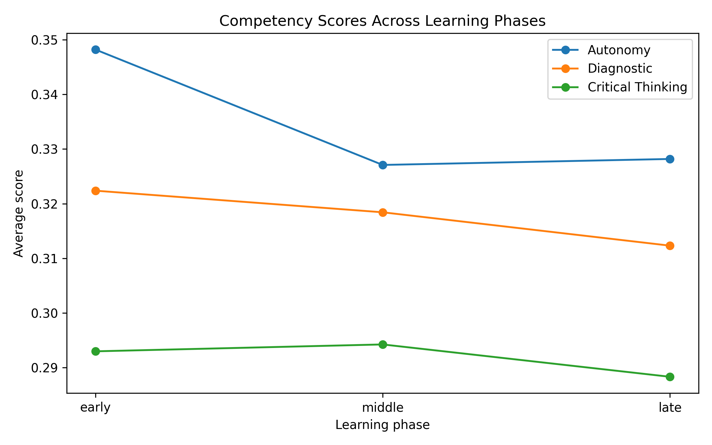

# StudyChat Analytics

**How do students actually use an AI assistant when they learn? This project measures it from real conversations.**

It analyses the [StudyChat dataset](https://huggingface.co/datasets/wmcnicho/StudyChat): conversations between university students and an AI assistant during a course. Each interaction is scored for evidence of three learning competencies, and each student gets a profile shown in a Streamlit dashboard.

## The three competencies

| Competency | Evidence looked for in a student's messages |
|---|---|
| **Autonomy** | Explaining their own attempt, asking specific questions, editing the answer, giving context, rather than delegating the whole task |
| **Diagnostic reasoning** | Stating the problem, investigating, giving context, modifying and verifying a solution |
| **Critical thinking** | Questioning the answer, verifying it, justifying choices, giving context |

## Pipeline

```
download_studychat.py   download the dataset from Hugging Face
src/preprocess.py       clean messages, split each student's activity into time phases
src/nlp.py              text signals + semantic similarity to each competency (all-MiniLM-L6-v2)
src/autonomy.py         autonomy score per interaction
src/diagnostic.py       diagnostic reasoning score
src/critical_thinking.py critical thinking score
src/analysis.py         student profiles and competency by phase
src/dashboard.py        Streamlit dashboard
```

Scores are **relative**: a student's level is their percentile inside the StudyChat cohort, and the analysis reports behaviour rates (how often evidence appears), not absolute competency percentages.

## Results

Figures in [`results/figures/`](results/figures):
- **Score distributions** per competency.
- **Average competencies** across students.
- **Competency progression** across the time phases of the course.
- **The 10 strongest student profiles.**



## Run it

```bash
pip install -r requirements.txt
python download_studychat.py            # saves StudyChat.jsonl; move it to data/
python src/preprocess.py
python src/nlp.py
python src/autonomy.py
python src/diagnostic.py
python src/critical_thinking.py
python src/analysis.py
streamlit run src/dashboard.py
```

## Stack

Python · pandas · scikit-learn · Sentence-Transformers · Hugging Face Datasets · Streamlit
